# IR-GPS: a GPS for incident response

**Turn-by-turn navigation for SOC analysts and incident responders.**
Give it a foothold and it plots the attacker's fastest routes to your crown jewels, gives you a breach ETA ("Finance DB falls in 15 min"), tells you which turn stops them, and **recalculates the route live as you contain it**, the way a GPS reroutes when you miss an exit.

Zero dependencies. No build step. It runs entirely in the browser, so no incident data leaves your machine.

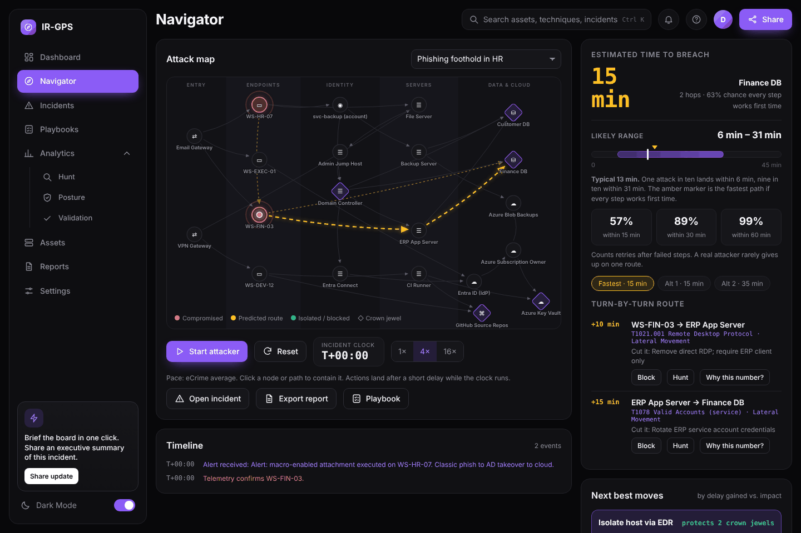

## Screenshots

**Reroute like a GPS.** Switch on three controls and the route, ETA and range recalculate: 15 min becomes 27 min, and the likely range widens to 14 min – 1 h 58 m.

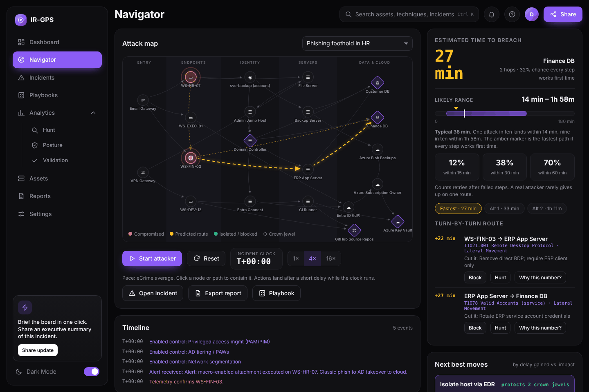

| | |
|---|---|
| **Dashboard.** ETA projection, breach-time histogram, and what drives the ETA.<br>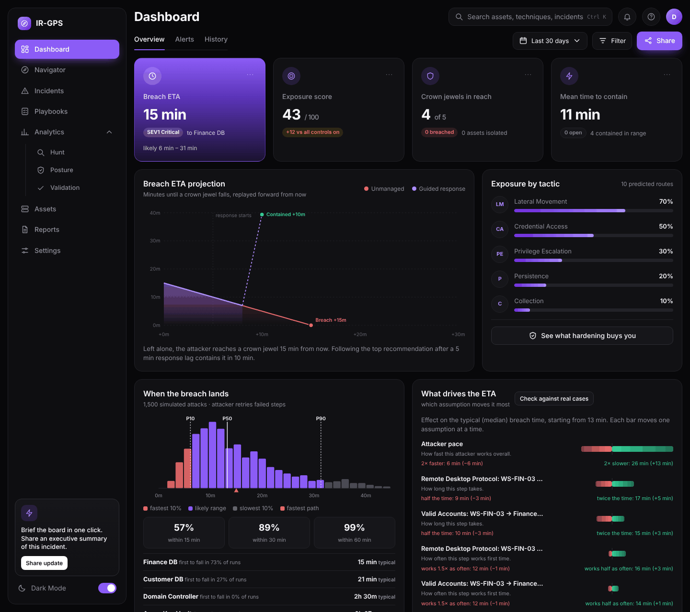 | **Why this number?** Every step explains its estimate, spread and evidence.<br>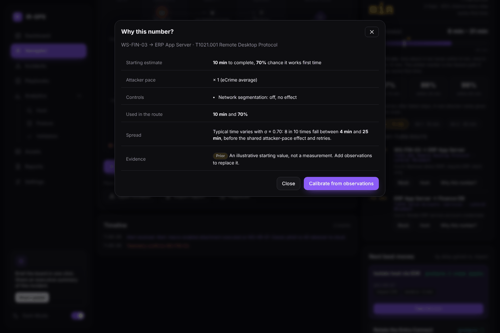 |
| **Validation.** The model replayed against six documented intrusions, labelled anecdotal.<br>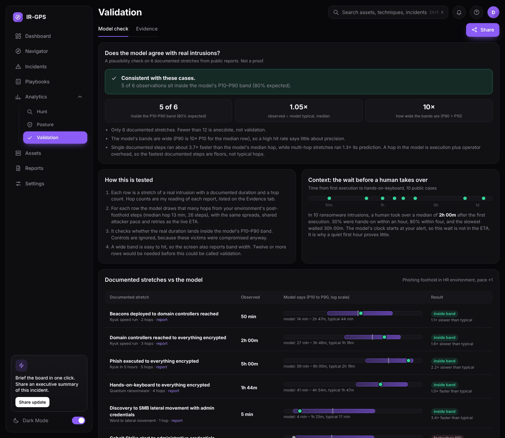 | **Calibration.** Turn your own timings into fitted values, with the prior kept for an exact undo.<br>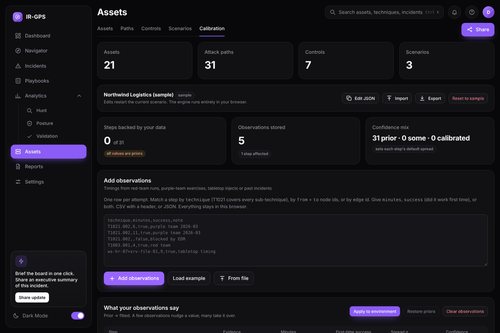 |
| **Posture.** Control coverage across the predicted attack paths.<br>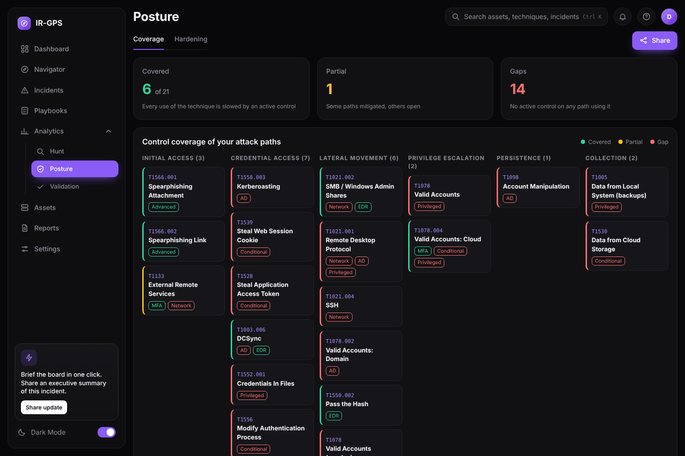 | **Hunt.** Where to look, what to look for, and starter queries per technique.<br>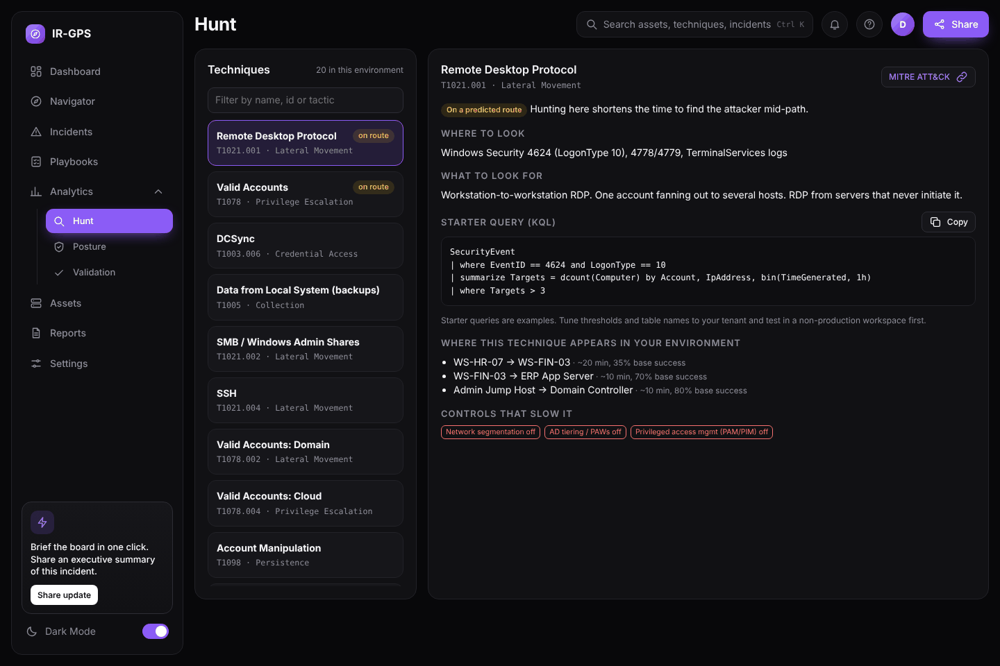 |
| **Playbooks.** NIST-aligned steps with roles, checked off live.<br>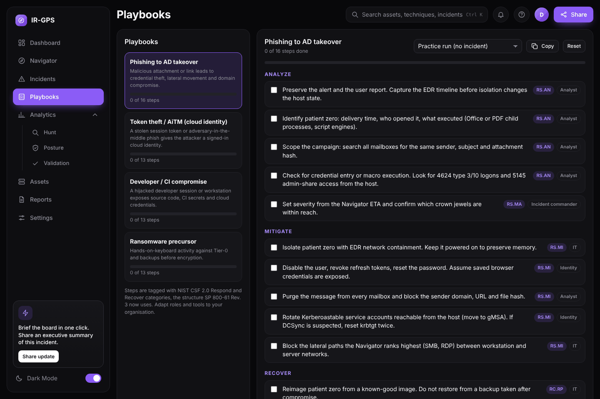 | **Incidents.** Register, regulatory clocks and snapshots.<br>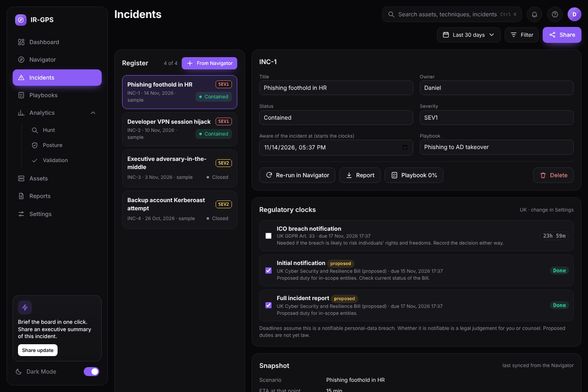 |
| **Reports.** Incident report, executive summary and CSV exports.<br>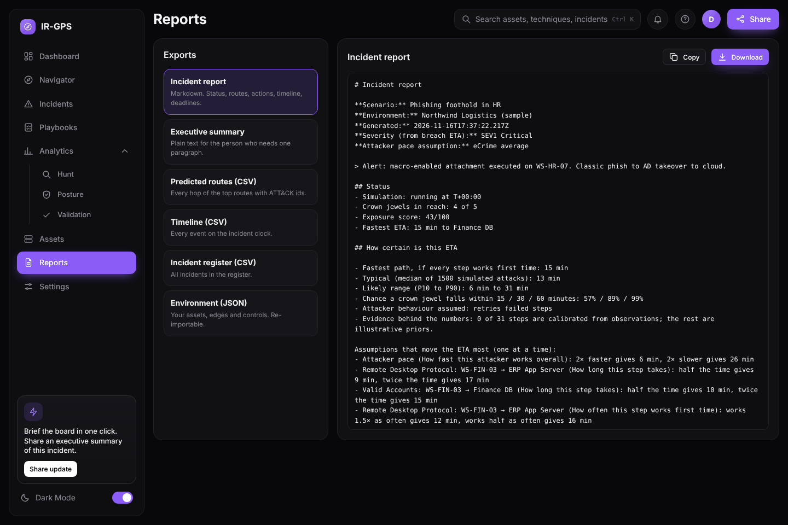 | **Light theme and mobile.**<br>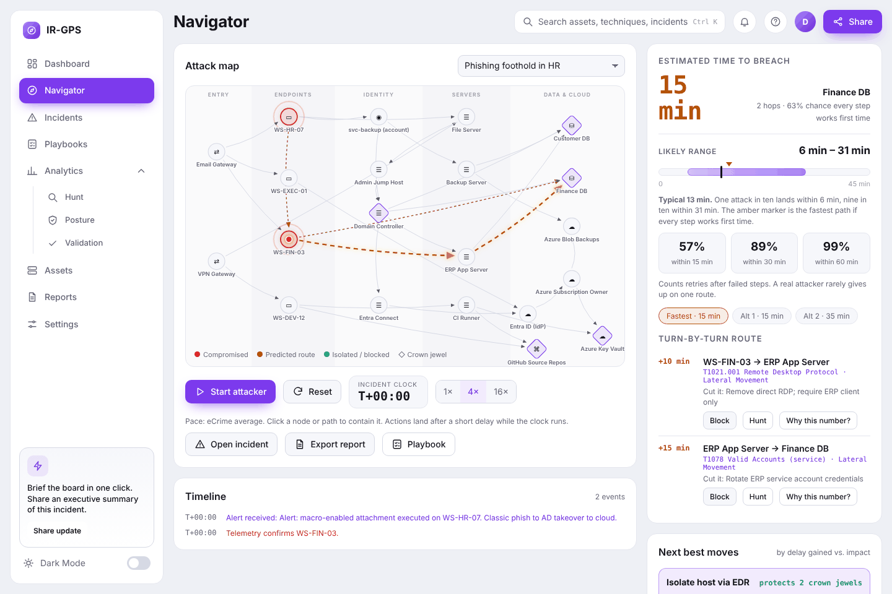 |

<p align="center">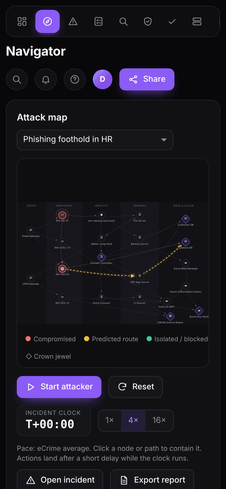</p>

The images are generated from the real app, so they stay accurate: `python3 tests/e2e/screenshots.py file://$PWD/index.html docs/screenshots`.

## Screens

| Screen | What it does |
|---|---|
| **Dashboard** | Breach ETA with its likely range, exposure score, crown jewels in reach, mean time to contain. A projection chart replays the incident twice, unmanaged versus guided response with your reaction lag. A histogram of when the breach lands, and **what drives the ETA** (which assumption moves it most). Exposure by ATT&CK tactic. Incident history with filters and a date range. |
| **Navigator** | The GPS. Attack map, ETA with a **likely range** ("15 min, most likely 6 to 31") and breach chances at 15, 30 and 60 minutes, turn-by-turn route with ATT&CK ids and a **Why this number?** panel per step, ranked containment moves, what-if control toggles, crown jewel status and a live attacker simulation with time-delayed actions. |
| **Incidents** | Case register. Status, severity, owner, playbook, notes, a snapshot of the Navigator, and **regulatory clocks** (UK GDPR, NIS2, proposed UK Cyber Security and Resilience Bill) with countdowns. |
| **Playbooks** | Four response checklists tagged with NIST CSF 2.0 categories (the structure of SP 800-61 Rev. 3). Progress is stored per incident. |
| **Hunt** | For each technique on your attack paths: where to look, what to look for, and a starter KQL query. |
| **Posture** | ATT&CK-style coverage matrix for your paths, plus a hardening advisor that prices each control in ETA and average exposure across all scenarios. |
| **Assets** | Edit the environment: calibrate minutes and odds, mark crown jewels, add assets, paths and scenarios, import or export JSON. The **Calibration** tab turns your own red-team, purple-team or tabletop timings (CSV or JSON) into fitted values, shows prior versus fitted before you apply, and can restore the priors exactly. |
| **Validation** | Replays six documented stretches of real intrusions from public reports against the model and shows whether the real durations fall inside its likely range, how wide that range is, and where the model is off. Labelled anecdotal, because six is not enough to validate anything. The Evidence tab lists every case, hop count and source link. |
| **Reports** | Markdown incident report, executive summary, CSV exports (routes, timeline, incidents), environment JSON. |
| **Settings** | Dark or light theme, attacker pace, whether the attacker retries failed steps, uncertainty width, response lag, jurisdiction, backup and restore, reset, method and sources. |

Also: command palette (`Ctrl K` or `/`), notifications, responsive layout, keyboard-accessible map.

## Why this is different (and what it is not)

Attack-path products exist (BloodHound, XM Cyber, Wiz, Trend Vision One Attack Path Prediction). They are built for posture review. IR-GPS is built for the incident-time question: *"The attacker is here. How long do I have, and which single move buys the most time for the least business damage?"* It combines a breach ETA, impact-weighted containment ranking and live rerouting in one view. See [docs/RESEARCH.md](docs/RESEARCH.md) for the evidence, the competitor review and the limits of that claim.

## Run it

```bash
npx serve .                 # or just open index.html
node tests/engine.test.js   # 25 engine tests, Node 18+, no install
node scripts/bundle.js      # writes dist/index.html, a single self-contained file
```

Optional browser tests (Python Playwright): `npm run e2e` drives every screen and checks about 60 behaviours.

## Deploy to Azure Static Web Apps

1. Push this repo to GitHub.
2. Azure Portal → *Create a resource* → **Static Web App** → connect the repo.
3. Build preset **Custom**. App location `/`. Output location and API location empty.
4. Azure adds a deployment secret to the repo. Make sure its name matches `AZURE_STATIC_WEB_APPS_API_TOKEN` in `.github/workflows/azure-static-web-apps.yml`, or edit the workflow.
5. In the repo, *Settings → Secrets and variables → Actions → Variables*, add `DEPLOY_AZURE` = `true`. Until then CI runs the 71 tests and the bundle build on every push, and the deploy job stays skipped.

`staticwebapp.config.json` sets security headers (CSP, no framing, no sniffing). The app loads only its own files and makes no network requests.

## Architecture

```
index.html                 shell
css/styles.css             design system (dark first, light theme)
js/engine.js               pure logic: routing, ranking, simulation, analytics, Monte Carlo ETA ranges, sensitivity (UMD, browser and Node)
js/calibration.js          fits your observed timings to edge values, shrunk toward the prior
js/validation.js           replays documented intrusions against the model
js/validation-data.js      the transcribed cases, hop counts, wait times and benchmarks, each with its source
js/data.js                 sample environment (Northwind Logistics) and scenarios
js/reference.js            detection guidance, playbooks, regulatory clocks, attacker pace profiles
js/ui.js                   helpers: icons, toasts, popovers, modals, clipboard
js/core.js                 state, persistence, simulation loop, incidents, notifications
js/unc.js                  shared widgets: range bar, histogram, driver bars, Why this number?
js/views/*.js              one file per screen
js/app.js                  router, sidebar, top bar, events, command palette
scripts/bundle.js          single-file build
tests/*.test.js            engine, uncertainty, calibration and validation tests (71 in all)
tests/e2e/                 Playwright browser tests
docs/RESEARCH.md           sourced research notes
```

**Model.** The environment is a directed graph. Each edge is an attacker move with an ATT&CK id, a base time in `minutes`, a success probability `p`, and the controls that mitigate it. An active control multiplies time by 2.2 and success odds by 0.5. Edge cost is `minutes + 25 x -ln(p)`. Footholds join a virtual source, giving multi-source Dijkstra, and Yen's algorithm gives alternative routes. Containment moves are ranked by simulating each isolation and path block: `(delay gained + 60 x crown jewels saved) / (1 + 0.5 x business impact)`.

**Analytics.** Exposure (0 to 100) measures how soon crown jewels fall within a 2 hour horizon. Severity follows the live ETA. The projection replays the incident forward with and without a responder following the top recommendation after a configurable lag. Hardening flips each control and measures the change across every scenario.

**Simulation.** The attacker moves hop by hop. Cutting a path mid-hop forces a recalculation. Each scenario has a `dwell` (minutes of attacker activity before the alert), replayed at start so the incident clock begins at T+00:00 with earlier compromises logged as pre-alert telemetry.

## Environment JSON

```jsonc
{
  "name": "My org",
  "zones": [{ "name": "Endpoints", "x0": 0, "x1": 300 }],          // optional; laid out automatically if missing
  "nodes": [{ "id": "dc-01", "label": "Domain Controller", "type": "server", "zone": "Identity",
              "x": 440, "y": 290, "crown": true, "businessImpact": 10 }],
  "edges": [{ "from": "a", "to": "b", "tid": "T1021.002", "tname": "SMB / Windows Admin Shares",
              "tactic": "Lateral Movement", "minutes": 15, "p": 0.6,
              "remedy": "Block SMB between VLANs", "controls": ["segmentation"], "impact": 2 }],
  "controls": [{ "id": "segmentation", "label": "Network segmentation", "desc": "…", "enabled": false }],
  "scenarios": [{ "id": "s1", "name": "Phish", "summary": "…", "compromised": ["a"], "dwell": 20 }]
}
```
Node `type`: `workstation | server | identity | cloud | data | gateway | saas`. Use **Assets → Export** for a full example, and **Edit JSON** to paste one in. Coordinates are 0 to 1000 by 0 to 640.

## Honest limitations

- Times and probabilities in the sample data are **illustrative**, tuned to published breakout times, not measured on a real network. Calibrate them in Assets before relying on an ETA.
- The likely range describes **the model's own uncertainty**, with spreads that are assumptions until you calibrate. It is not a statistical confidence interval around reality. Calibrating from a few observations narrows it only as far as the evidence earns.
- The headline ETA is the fastest path if every step works first time. The typical value and the range are separate and usually longer.
- Persistent attacker (retries failed steps) is the cautious default. With it off, breach chances are lower bounds.
- Validation uses six documented stretches transcribed by hand from public reports, so it is anecdotal. The check can fail, and a wide band is easy to hit, which is why band width is reported next to the hit rate.
- You supply the graph. There is no auto-discovery or live alert ingestion yet.
- Regulatory clocks assume a notifiable personal-data breach. Notifiability is a legal call. The proposed UK Bill duties are marked as proposed.
- Starter KQL queries need tuning to your tenant.
- Decision support only. Validate against real telemetry before acting.

## Roadmap

- Sentinel and Defender XDR connector to seed footholds and edge odds
- BloodHound, Entra and Azure Resource Graph importers
- Ransomware "time to encryption" and multi-attacker scenarios
- Team mode with approvals

## Portfolio talking points

- Weighted attack-graph engine with multi-source Dijkstra and Yen's k-shortest paths, plus a seeded Monte Carlo layer that turns a single ETA into a range and ranks the assumptions that move it. 71 unit tests.
- Honest about uncertainty: every number says how much evidence stands behind it, calibration shrinks toward a prior so a handful of data points cannot swing the model, and a validation screen shows where the model disagrees with real incidents.
- Every attacker move mapped to MITRE ATT&CK, every defender action to a business-impact trade-off.
- Live simulation with time-delayed containment, dynamic rerouting and an unmanaged-versus-guided projection.
- Playbooks aligned to NIST SP 800-61 Rev. 3 and CSF 2.0, regulatory clocks for UK and EU.
- Zero-dependency static app with CSP headers, CI, browser tests and Azure Static Web Apps deployment.
